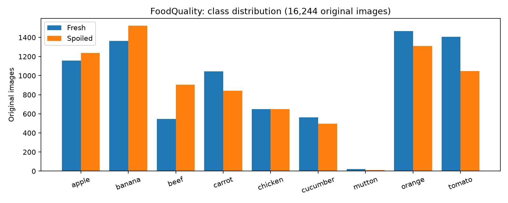
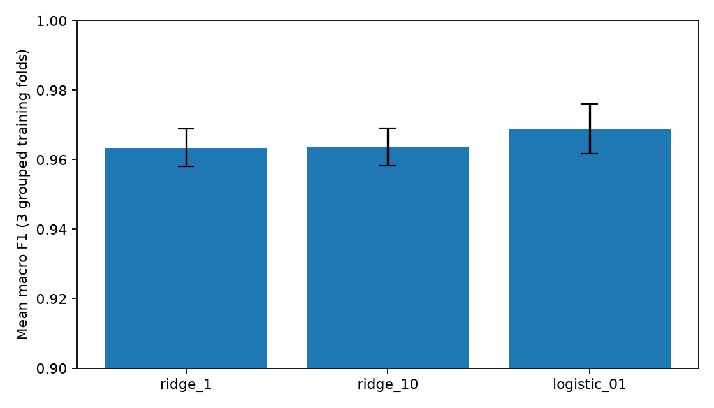
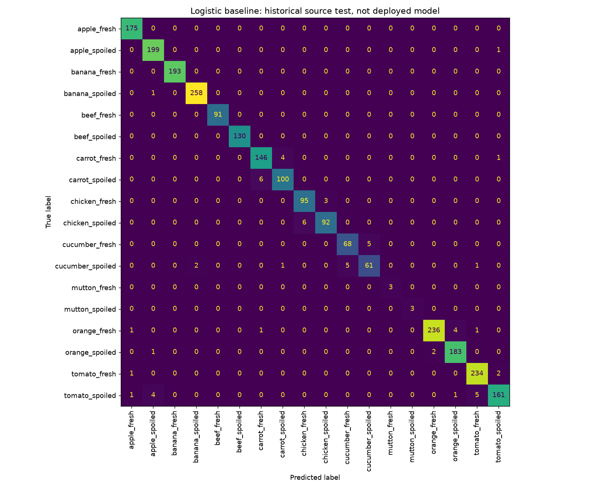
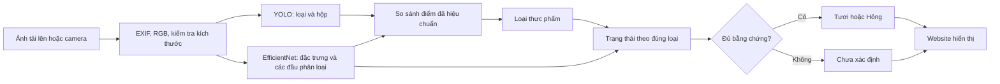

# FoodQuality — nghiên cứu và xây dựng hai mô hình

Ngày thực nghiệm: 30/10/2026. Mục tiêu là chọn cấu hình có bằng chứng phù hợp với chín loại thực phẩm của dự án, không tuyên bố một mô hình tốt nhất trên mọi ảnh.

## 1. Xác định bài toán

Đầu vào là ảnh JPG/PNG/WEBP, một loại thực phẩm chủ đạo. Đầu ra gồm tên loại, điểm nhận diện, trạng thái Tươi/Hỏng hoặc Chưa xác định, điểm phân loại, và hộp giới hạn khi detector có bằng chứng. Chín loại: bò, gà, cừu, táo, chuối, cam, cà chua, dưa chuột, cà rốt.

Đây là học có giám sát: nhận diện đối tượng gồm phân loại và hồi quy tọa độ hộp; chất lượng là phân loại nhị phân có điều kiện theo loại thực phẩm. Không phải clustering. Từ chối trả trạng thái khi thiếu bằng chứng là hành vi suy luận, không phải một lớp hỏng mới được huấn luyện.

Quy tắc màu đen/trắng không đủ: mỡ, da, phản sáng, bóng đổ, giống quả, độ chín và nền ảnh có thể giống dấu hiệu hỏng. Mô hình học đặc trưng hình dạng, kết cấu và màu từ dữ liệu. Các thống kê màu chỉ bổ sung đặc trưng, không có quy tắc “đốm trắng = hỏng”. Ảnh không đo được vi sinh, mùi, lịch sử bảo quản; kết luận chỉ về ngoại quan.

## 2. Chất lượng dữ liệu

Dataset hiện có 16.244 ảnh gốc: FoodClass V2 13.475, AgML raw 1.181, AgriFreshNET V1 1.588. Nguồn và giấy phép xem [data-sources.md](data-sources.md). Nhãn công khai là bằng chứng nguồn, không đồng nghĩa đã được chuyên gia của dự án xác nhận. Ảnh Google là dữ liệu nhập thử nghiệm riêng, không tự trở thành nhãn kiểm chứng.

Kiểm toán chỉ mục: không thiếu tệp, không thiếu nhãn, không trùng SHA-256, không có nhóm `duplicate_group` nằm ở nhiều split. Đây là kiểm tra theo nhóm đã ghi trong manifest, không chứng minh đã phát hiện mọi ảnh gần trùng hoặc mọi mẫu cùng lô chụp.

Mất cân bằng đáng kể: mutton chỉ có 32 ảnh, trong đó train 20, validation 6, test 6. Lớp mutton hỏng chỉ có 5 ảnh train. Không dùng accuracy trung bình để che hạn chế này; cần báo cáo từng lớp, macro F1 và recall ảnh hỏng. Chưa có tập ảnh người dùng thu độc lập hoặc kiểm chứng loài “mutton” cho từng ảnh.

## 3. Tiền xử lý và tránh rò rỉ

1. Kiểm tra ảnh đọc được, kích thước và độ mờ; loại tệp hỏng, ảnh thiếu nhãn khỏi dữ liệu có giám sát. Không điền nhãn thiếu bằng tên truy vấn như thể đã xác nhận.
2. SHA-256 kiểm tra nội dung; pHash hỗ trợ nhóm gần trùng. Nhãn mâu thuẫn trong nhóm được loại hoặc đưa ra duyệt. Khi chuyển Excel giữa máy, giữ đường dẫn tương đối và ảnh gốc, không học từ thumbnail nếu có ảnh gốc.
3. EXIF transpose, RGB, chuẩn hóa ImageNet. Công thức chi tiết dùng hai vùng 320×320: toàn ảnh và vùng bỏ viền 6%, có padding để giữ tỉ lệ. Biến thể chỉ tạo từ train; ảnh dẫn xuất giữ liên kết về ảnh cha.
4. Mã hóa loại thực phẩm theo danh sách cố định; fresh=0, spoiled=1. Đầu phân loại trạng thái có hai logit cho mỗi loại.
5. Encoder tạo 1.280 đặc trưng; 51 đặc trưng histogram HSV và thống kê ngoại quan được nối thành 1.331 chiều. Mean/std chỉ fit trên train; chặn đặc trưng chuẩn hóa trong [-8,8] để giảm tác động giá trị cực đoan. Không loại ảnh tối chỉ vì nghi hỏng.
6. Split gốc: train 11.159, validation 2.597, test 2.488. Nhóm không đi qua ranh giới split. Cache chỉ tái sử dụng khi khớp SHA ảnh, công thức tiền xử lý và encoder.

Tập test này đã xuất hiện trong các đợt phát triển trước. Vì vậy gọi là **test nội bộ theo nguồn**, không gọi là test thực địa độc lập chưa từng xem. Train/val/test không trùng nhóm là điều kiện cần, chưa đủ để loại mọi domain leakage.

## 4. Nghiên cứu bản Drive và lựa chọn thuật toán

Đã kiểm tra trực tiếp bốn checkpoint của FoodVision-AI-V2-Demo:

| Thành phần | Phát hiện | Quyết định |
| --- | --- | --- |
| YOLO Food | SHA-256 `8af820e…cf17`, giống hệt detector hiện tại; 214 tên lớp | Tái sử dụng một lần, không chạy hai bản giống nhau để “tăng độ tin cậy” |
| YOLO Raw | YOLO11n, 2.605.855 tham số, 5 lớp shrimp/fish/chicken/pork/beef | Thử nghiệm; không thay trực tiếp detector cho chín loại |
| EfficientNet Meat | Fresh/Half-Fresh/Spoiled, checkpoint ghi epoch 3 | Thử nghiệm đúng phạm vi; Half-Fresh không tự đổi thành Hỏng |
| EfficientNet Fish | Fresh/NonFresh/VeryFresh | Ngoài phạm vi chín loại, không nhập vào pipeline chính |

Gói Drive không có dataset, nhãn hộp, mã train đầy đủ hoặc split gốc. Các chỉ số nhúng trong checkpoint chỉ là số liệu do gói cung cấp. Ví dụ YOLO Raw lưu mAP50=0,74905 và mAP50–95=0,4815; chưa thể tái lập trên dataset gốc. Không so các số này với accuracy phân loại để kết luận thắng/thua.

Thử nghiệm trên validation hiện tại cho YOLO Raw: bò đúng 139/230 ảnh (60,43%), gà 0/196 ở ngưỡng 0,25 và ảnh 416px. Đây là độ đúng tên loại của detection có điểm cao nhất, **không phải mAP khoanh vùng**. Các loại không nằm trong label space không được dùng để tuyên bố model kém trên bài toán gốc của nó. Domain shift hoặc khác nhãn có thể giải thích suy giảm.

Meat classifier khi thử trên toàn ảnh bò chỉ đúng 33,48% theo quy ước Half-Fresh→Chưa xác định. Đây là kiểm tra chuyển miền; pipeline gốc dùng crop và chỉ gán bộ thịt cho beef/pork, không cho chicken/mutton. Thử lại đúng luồng crop trên 230 ảnh bò cho tỷ lệ đúng đồng thời loại và trạng thái 11,30%; thiếu detection hoặc Half-Fresh được tính là chưa trả đúng, không loại khỏi mẫu số. Kết quả ghi riêng trong `research-results.json`. Không suy rộng số toàn ảnh thành kết luận cho mọi crop hoặc dữ liệu gốc của tác giả.

Ngoài neural heads hiện có, đã huấn luyện Ridge alpha=1, Ridge alpha=10 và Logistic Regression C=0,1 trên đặc trưng encoder cố định. Dùng 3-fold StratifiedGroupKFold chỉ trong train; StandardScaler được fit riêng mỗi fold. Chọn thuật toán theo macro F1 trung bình, rồi mới đánh giá validation/test. Logistic đạt CV trung bình khoảng 96,89%, validation macro F1 97,73%; không chứng minh tốt hơn mọi khía cạnh của đầu chất lượng hiện tại nên không tự thay checkpoint.

Baseline Ridge/Logistic dùng đặc trưng một vùng 224px và phân loại 18 lớp kết hợp; model đang dùng có hai vùng 320px và đầu trạng thái theo loại. Đây là so sánh hệ thống, không phải ablation chỉ đổi thuật toán trên cùng công thức đặc trưng.

YOLO thuận lợi cho vị trí đối tượng và chạy thời gian thực, nhưng bị giới hạn bởi lớp/nhãn hộp và domain train. EfficientNet transfer learning giảm chi phí train, nhưng vẫn nhạy với nền và nguồn dữ liệu. Phân loại tuyến tính dễ kiểm soát, nhanh, song encoder cố định giới hạn khả năng thích ứng. Kết hợp nhiều mô hình không mặc nhiên tăng accuracy, nhất là khi hai checkpoint giống nhau hoặc điểm chưa hiệu chuẩn.

## 5. Xây dựng và huấn luyện

Hai checkpoint trong cấu hình `dual`:

**Model 1 — YOLO nhận diện/khoanh vùng:** dùng checkpoint đã có, không tuyên bố vừa train YOLO từ đầu trong đợt nghiên cứu này. `ai_detection/training.py` cung cấp mã fine-tune YOLO trên release có nhãn hộp; mặc định chạy seed=42, batch theo cấu hình, early stopping và đánh giá val/test. Vùng tạo bằng heuristic được đánh dấu thử nghiệm, không coi là ground truth để báo mAP chính thức. Detector hiện tại không có lớp mutton; không tuyên bố khoanh vùng đủ cả chín loại.

**Model 2 — encoder EfficientNet + các đầu nhận dạng/trạng thái:** giữ checkpoint chất lượng đã huấn luyện trong dự án. Encoder đóng băng, hai đầu tuyến tính được học từ đặc trưng 1.331 chiều; đầu trạng thái được chọn theo loại. Đầu nhận dạng của model 2 hỗ trợ trường hợp YOLO không bao phủ loại hoặc thiếu detection. Vì vậy pipeline có hai checkpoint nhưng model 2 cũng góp phần nhận diện, không phải chỉ đọc màu.

`scripts/train_food9.py` có mã huấn luyện: AdamW, learning rate mặc định 0,003, weight decay 0,01, batch đặc trưng 256, seed=42, label smoothing 0,05, trọng số lớp theo căn nghịch đảo tần suất; tối đa 180 epoch, dừng sau 20 vòng không cải thiện. Mean/std chỉ từ train. Checkpoint giữ encoder, đầu loại, đầu trạng thái, tiền xử lý, mean/std. Các đợt tối ưu trước có thay LR, trọng số hỏng và ensemble; thông số của từng checkpoint phải đọc từ run tương ứng, không coi mặc định CLI là thông số chính xác của mọi run.

Huấn luyện thêm trong đợt này là ba cấu hình Ridge/Logistic và 3-fold CV. Chưa fine-tune backbone/Yolo mới vì thiếu dataset hộp đã xác minh của bản Drive. Không bịa learning curve hoặc cross-validation cho YOLO chưa thực hiện.

Kiểm soát overfitting: chỉ tạo augmentation trên train, regularization, early stopping bằng validation, phân tích per-class và nguồn, không chọn threshold bằng test. Underfitting cần xem đồng thời train/val, không chỉ tăng epoch. Candidate không tự ghi đè trọng số cũ.

## 6. Đánh giá và phân tích lỗi

Đánh giá nhận dạng: accuracy, per-class precision/recall/F1 và macro F1. Đánh giá trạng thái: recall hỏng, số hỏng→tươi, độ phủ trả lời, độ đúng trong câu trả lời được chấp nhận và tỷ lệ vừa trả lời vừa đúng trên toàn bộ ảnh. Unknown không bị loại khỏi mẫu số của chỉ số toàn bộ ảnh. Chỉ báo mAP50/mAP50–95 khi có ground-truth box độc lập.

| Validation sạch (2.597 ảnh) | Bản ba nguồn | Hai checkpoint |
| --- | ---: | ---: |
| Đúng loại | 98,96% | 99,11% |
| Có trả trạng thái | 94,88% | 96,26% |
| Đúng trong phần đã trả | 99,03% | 98,96% |
| Vừa trả và đúng loại + trạng thái | 93,95% | 95,26% |
| Recall hỏng đúng loại | 93,33% | 94,59% |
| Số ảnh hỏng trả nhầm tươi | 9 | 8 |

Đánh đổi: độ đúng có điều kiện giảm khoảng 0,066 điểm phần trăm, trong khi nhận diện, độ phủ, đúng toàn luồng và recall hỏng cải thiện. Không mô tả tất cả chỉ số đều tăng. Ngưỡng chất lượng giữ 0,8; lựa chọn kiến trúc dựa trên validation. Ảnh xoay, tối/mờ và che góc cũng được đối chiếu; đây là biến thể của validation, không phải dữ liệu thực địa mới.

Đã xác minh 18 trường hợp (mỗi loại/trạng thái một ảnh) cho kết quả của mã hai-model trùng với phép loại bỏ nhánh SIC trong pipeline cũ. Sau khi cố định cấu hình, chạy test nội bộ 2.488 ảnh để báo cáo, không chỉnh lại ngưỡng theo test. Kết quả chi tiết và lỗi từng lớp nằm trong `research-results.json` và phần kết quả test bổ sung bên dưới.

### Kết quả test nội bộ và quyết định triển khai

| Test 2.488 ảnh | Bản hiện tại | Hai checkpoint |
| --- | ---: | ---: |
| Đúng loại | 99,40% | 99,48% |
| Có trả trạng thái | 94,17% | 95,42% |
| Đúng trong phần đã trả | 99,23% | 99,07% |
| Vừa trả và đúng loại + trạng thái | 93,45% | 94,53% |
| Recall hỏng đúng loại | 93,38% | 94,69% |
| Số ảnh hỏng trả nhầm tươi | 8 | 10 |

Hai checkpoint tăng nhận diện và độ phủ, nhưng số hỏng→tươi tăng 2 ảnh. Chưa kết luận khác biệt nhỏ này có ý nghĩa thống kê; báo cáo JSON có bootstrap ghép cặp theo nhóm ảnh, 1.000 lần lấy mẫu, seed 42. Vì ưu tiên giữ chất lượng hiện tại, **stable vẫn là mặc định; dual là bản nghiên cứu chạy riêng**. Không retune ngưỡng hoặc checkpoint sau khi xem test. Chưa có bằng chứng để gọi dual tốt hơn về mọi tiêu chí hoặc thay model chính thức.

Biểu đồ confusion trên là **Logistic baseline**, không phải model website. Đây là ví dụ phân tích lỗi thật của thuật toán đối chứng; không đổi nhãn biểu đồ để gán cho model triển khai.

## 7. Tích hợp website và cách trình bày

Ảnh không bị upload tới API ChatGPT. Website chạy model cục bộ. Crop không được đưa vào model chất lượng một cách tùy ý vì model đang học công thức toàn ảnh + vùng chi tiết; thay đổi crop distribution phải được đánh giá trước. Cách phân tích crop của bản Drive là hướng tham khảo, chưa có bằng chứng để bật trên mọi loại.

`foodquality8/ai_detection/dual.py` là mã suy luận hai checkpoint. `user_app.py` đọc ảnh, cache model theo hash cấu hình/mã và hiển thị. `chay_web.py --profile dual` mở bản hai model; `--profile stable` giữ đường quay lại bản ba nguồn. Không cần thêm nút kỹ thuật vào trang người dùng.

Kịch bản trình bày: giải thích input/output → chỉ manifest và phân phối lớp → mở mã train và saved checkpoint → trình bày bảng so sánh/CV → tải ảnh lên web → giải thích cách từ chối ảnh thiếu bằng chứng → nhập dữ liệu mới qua `nhap_du_lieu.py`. Nhập ảnh mới không tự làm model biết ảnh đó; phải tạo dataset, train, đánh giá, rồi kích hoạt phiên bản mới. Bộ 9 loại chính thức cần dataset đủ lớp; demo một loại không được thay thế toàn bộ model 9 loại.

## Tái lập và tài liệu tham khảo

Các script nghiên cứu không tải dữ liệu mới hoặc gửi ảnh ra ngoài: `benchmark_external_models.py`, `compare_algorithms_cv.py`, `evaluate_dual.py`. Checkpoint Drive chỉ dùng cục bộ để đối chiếu; không đưa lại trọng số đó vào repo khi chưa có điều khoản phân phối.

- [Ultralytics: validation và chỉ số detection](https://docs.ultralytics.com/modes/val/).
- [scikit-learn: StratifiedGroupKFold](https://scikit-learn.org/stable/modules/generated/sklearn.model_selection.StratifiedGroupKFold.html).
- [scikit-learn: hiệu chuẩn xác suất](https://scikit-learn.org/stable/modules/calibration.html).

Hạng mục chưa hoàn thành để bảo vệ ở mức cao hơn: bộ test camera mới thu độc lập, xác minh nhãn chất lượng bởi người có chuyên môn, ground-truth box cho đủ chín loại và ảnh nhiều đối tượng, khoảng tin cậy theo lô chụp được xác minh (bootstrap hiện chỉ theo nhóm có sẵn), đánh giá tốc độ trên thiết bị đích và kiểm tra giấy phép toàn bộ trọng số bên thứ ba.
